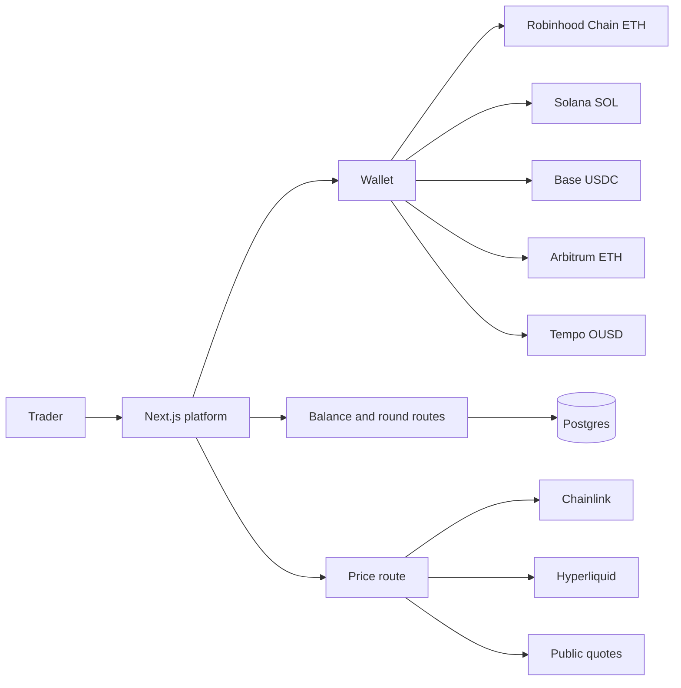
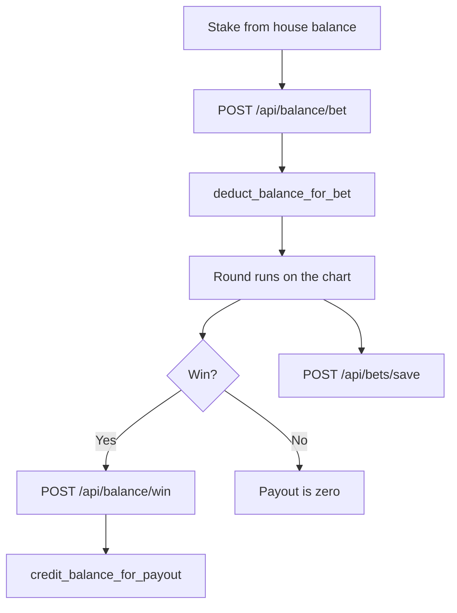

# TapT

Binary options trading platform for crypto, stocks, metals, and FX. A round lasts 5 seconds to 1 minute and settles from a house balance.

The product name is TapT. The site and referrals stay on tapt.fun. The repository is [TapT](https://github.com/AmaanSayyad/TapT).

| | |
|---|---|
| **Site** | https://tapt.fun |
| **GitHub** | https://github.com/AmaanSayyad/TapT |
| **Contact** | https://t.me/amaan029 |

---

## Table of Contents

1. [Overview](#overview)
2. [How a round works](#how-a-round-works)
3. [Trader modes](#trader-modes)
4. [Chains and wallets](#chains-and-wallets)
5. [House balance](#house-balance)
6. [Fees](#fees)
7. [Prices](#prices)
8. [Tech stack](#tech-stack)
9. [Architecture](#architecture)
10. [Database](#database)
11. [API](#api)
12. [Admin dashboard](#admin-dashboard)
13. [Directory](#directory)
14. [Environment](#environment)
15. [Local development](#local-development)
16. [Deployment](#deployment)
17. [Security](#security)

---

## Overview

TapT is a binary options trading platform. A trader connects a wallet, deposits that chain’s asset into the treasury, and receives a house balance. Rounds debit that balance. A win pays the stake times the multiplier back into the same balance. The stake is not sent on-chain for every round.

Crypto, stocks, metals, and FX share one chart. Robinhood Chain is the primary chain. Solana, Base, Arbitrum, and Tempo follow, in that order.

Each chain has its own treasury and its own house balance. Robinhood Chain uses ETH. Solana uses native SOL. Base uses USDC, Arbitrum uses ETH, and Tempo uses OUSD. There is no project token in the app.

---

## How a round works

```
1. Fund
   Connect a wallet on one of the five chains.
   Send that chain’s asset to its treasury.
   The net amount, after the fee, is credited as a house balance.

2. Place
   Pick Classic, Box, or Draw.
   Set the stake from the house balance.
   Classic also sets a window: 5s, 10s, 15s, 30s, or 60s.

3. Settle
   The stake leaves the house balance immediately. No wallet signature.
   The round settles against the live chart price.
   A win credits stake × multiplier. A miss pays zero.
```

Deposits, withdrawals, and payouts are recorded in the ledger. The chart price is the settlement price. A market with no quote stays blank, and a round is not settled against a blank quote.

---

## Trader modes

### Classic

Higher or Lower against the open price. The open is the price when the round starts.

- Higher wins when the close is above the open.
- Lower wins when the close is below the open.
- A tie pays zero.

| Window | Multiplier |
|---|---|
| 5s | 1.75× |
| 10s | 1.80× |
| 15s | 1.85× |
| 30s | 1.90× |
| 60s | 1.95× |

### Box

The chart shows a grid of tiles. Each tile is a price band and shows its multiplier. The trader taps a tile. The round wins when the live price is inside that band.

### Draw

The trader draws a rectangle to the right of the live price. The rectangle is the band. It wins when the close at the end of the band is still inside it. The band cannot be taller than 20% of the chart or wider than 20 seconds.

### Blitz

Blitz is an overlay on Box, not a fourth mode. A window opens on a repeating cycle. The entry fee is $0.10, paid on-chain in that chain’s asset to that chain’s treasury, not from the house balance. Marked cells in that window pay 2×.

### Demo

Demo uses a practice balance on this browser. It is not the house ledger and it is not on-chain. Admin stats keep live rounds and demo rounds apart.

The chart can show SMA 20, Bollinger bands (20, 2), Alligator, and RSI 14. Those lines use the same ticks as the price path.

---

## Chains and wallets

Robinhood Chain is the primary chain and the default connection. Solana, Base, Arbitrum, and Tempo follow, in that order.

| Chain | Asset | How you connect | Explorer |
|---|---|---|---|
| Robinhood Chain | ETH | EVM wallet list | https://robinhoodchain.blockscout.com |
| Solana | SOL | Phantom or Backpack | https://solscan.io |
| Base | USDC | EVM wallet list | https://basescan.org |
| Arbitrum | ETH | EVM wallet list | https://arbiscan.io |
| Tempo | OUSD | EVM wallet list | https://explore.tempo.xyz |

Solana is forced to mainnet-beta. A Solana transfer includes a priority fee. A Tempo transfer uses `transferWithMemo`. The memo is the recipient address, left-padded to 32 bytes, and the fee is extra OUSD.

Robinhood Chain and Arbitrum balances are ETH. Base is USDC (`0x833589fCD6eDb6E08f4c7C32D4f71b54bdA02913`, 6 decimals). Tempo is OUSD (`0x20c0000000000000000000006a37da5c996874be`, 6 decimals).

Older chain folders still exist in `lib/`. They are not in the connect list.

---

## House balance

- One balance row per wallet and currency.
- A round calls `deduct_balance_for_bet`. A win calls `credit_balance_for_payout`. Both write `balance_audit_log`.
- The server checks `bet_id` before a payout, so the same round is not credited twice.
- The client removes the round from the active list before the payout request, so a slow response cannot settle it twice.

### Deposits

The trader sends that chain’s asset to its treasury. The server checks the transaction, takes the tier fee, and credits the rest.

### Withdrawals

The trader signs this message on Robinhood Chain, Base, Arbitrum, and Tempo. The server rejects a signature older than five minutes.

```
TapT withdrawal authorization
address:${address}
amount:${amount.toFixed(8)}
currency:${currency}
signedAt:${signedAt}
```

Withdrawals at or under $10 complete immediately on every chain. Anything above $10 waits for review.

A mainnet withdrawal cannot exceed `total deposited × 1.08`. From the 11th withdrawal onward, the request waits in the manual queue.

### Fees

Deposits and withdrawals take 1% on Free, 0.9% on Standard, and 0.8% on VIP. The fee comes off the amount. `calculateFeeAmount` floors it to 8 decimals.

The EVM fee wallet covers Robinhood Chain first, then Base, Arbitrum, and Tempo. Solana uses `NEXT_PUBLIC_PLATFORM_FEE_WALLET_SOL`. Those wallets are separate from the treasuries.

The Blitz entry fee is $0.10, paid once per window to that chain’s treasury. It is not taken from the house balance.

### Referrals

Each wallet gets a code. A new wallet that opens TapT from that link is counted once, when it registers. The count is not a payout. Links use `https://tapt.fun/?ref=`.

### Access codes and waitlist

Invite codes live in `access_codes`. The waitlist collects email at `/waitlist`. Both are managed from the admin dashboard.

---

## Fees

Deposits and withdrawals take 1% on Free, 0.9% on Standard, and 0.8% on VIP. `calculateFeeAmount` floors the fee to 8 decimals. The EVM fee wallet covers Robinhood Chain first, then Base, Arbitrum, and Tempo. Solana uses `NEXT_PUBLIC_PLATFORM_FEE_WALLET_SOL`. Those wallets are separate from the treasuries.

The Blitz entry fee is $0.10, paid once per window to that chain’s treasury. It is not taken from the house balance.

---

## Prices

Each asset uses the first source that returns a live price.

1. Stocks use the Chainlink feed on Robinhood Chain.
2. Anything still missing uses Hyperliquid mids.
3. Anything still missing uses public quotes.

The chart asks about once a second and keeps the last good price if a request fails. `PYTH_PRO_ENABLE` stays `false`. The platform does not depend on that flag.

---

## Tech stack

| Frontend | Wallets | Server |
|---|---|---|
| Next.js 16, App Router, Turbopack | Robinhood Chain first, through ConnectKit and wagmi. Then Solana (Phantom, Backpack), Base, Arbitrum, and Tempo | Next.js route handlers |
| React 19, TypeScript | Solana uses web3.js and wallet-adapter | Supabase Postgres and RPCs |
| Tailwind CSS v4 | | Chainlink on Robinhood Chain, Hyperliquid mids, public quotes |
| Zustand | | |

Package manager is Yarn v1 through Corepack. Node 22.

---

## Architecture

| Slice | What it holds |
|---|---|
| `walletSlice` | Address, network, preferred network |
| `gameSlice` | Mode, asset, price, active and settled rounds, tour |
| `balanceSlice` | House balance, demo balance, tier |
| `historySlice` | Local round history |
| `referralSlice` | Code and count |
| `profileSlice` | Username and recent rounds |

They combine into `useOverflowStore` in `lib/store/index.ts`.





---

## Database

| Table | Purpose |
|---|---|
| `user_balances` | Balance per wallet and currency, plus tier |
| `balance_audit_log` | Deposit, withdrawal, bet, payout, fee |
| `bet_history` | Settled rounds |
| `user_profiles` | Username |
| `user_referrals` | Code, referred-by, count |
| `access_codes` | Invite codes |
| `waitlist` | Emails |
| `user_sessions` | Time on the desk |
| `withdrawal_requests` | Review queue |

| RPC | Purpose |
|---|---|
| `update_balance_for_deposit` | Credit a deposit |
| `deduct_balance_for_bet` | Debit a stake |
| `credit_balance_for_payout` | Credit a win |
| `update_balance_for_withdrawal` | Debit a withdrawal |
| `increment_referral_count` | Add one joined wallet |

Writes use the service role on the server. Migrations are in `supabase/migrations/`.

---

## API

### Balance and rounds

| Method | Route | Purpose |
|---|---|---|
| `GET` | `/api/balance/[address]` | House balance for a wallet |
| `POST` | `/api/balance/deposit` | Record a deposit |
| `POST` | `/api/balance/withdraw` | Send a withdrawal |
| `POST` | `/api/balance/bet` | Debit a stake |
| `POST` | `/api/balance/win` | Credit a win |
| `POST` | `/api/bets/save` | Store a settled round |
| `GET` | `/api/bets/history` | Recent rounds |
| `GET` | `/api/bets/leaderboard` | Public board |

### Account

| Method | Route | Purpose |
|---|---|---|
| `GET` / `POST` | `/api/referral` | Code, count, and the public referrer list |
| `POST` | `/api/validate-access-code` | Check an invite code |
| `POST` / `DELETE` | `/api/session/ping` | Session time |
| `GET` | `/api/withdrawals` | That wallet’s withdrawal requests |
| `GET` | `/api/stats/public` | Public totals for the home page |

### Prices

| Method | Route | Purpose |
|---|---|---|
| `GET` / `POST` | `/api/pyth/latest` | Latest prices for the chart |

The route name is historical. The desk fills prices from Chainlink, Hyperliquid, then public quotes.

### Admin

All of these require the admin session from `DASHBOARD_PASSWORD`.

| Method | Route | Purpose |
|---|---|---|
| `POST` | `/api/admin/auth` | Log in |
| `POST` | `/api/admin/logout` | Log out |
| `GET` | `/api/admin/stats` | Live and demo totals |
| `GET` | `/api/admin/mode-analytics` | Totals by mode |
| `GET` | `/api/admin/player-ledger` | Per-wallet ledger |
| `GET` | `/api/admin/users` | Ledger rows |
| `GET` | `/api/admin/transactions` | Deposits and withdrawals |
| `GET` | `/api/admin/game-history` | Settled rounds |
| `GET` | `/api/admin/treasury-balances` | On-chain treasury balances |
| `GET` | `/api/admin/wallet-insights` | One wallet, across the ledger |
| `GET` | `/api/admin/waitlist` | Waitlist |
| `GET` / `POST` | `/api/admin/access-codes` | Invite codes |
| `GET` | `/api/admin/withdrawal-requests/pending` | Review queue |
| `POST` | `/api/admin/withdrawal-requests/[id]/accept` | Accept |
| `POST` | `/api/admin/withdrawal-requests/[id]/reject` | Reject |

---

## Admin dashboard

`/dashboard` is behind the access key. The key signs a cookie. It is not stored in the browser as the password.

The top of the page switches between live rounds and demo rounds. Under that: treasury balances, then the section tabs.

| Tab | What it shows |
|---|---|
| Wallet | One address: balances, audit, rounds, withdrawals, time on the desk |
| Ledger | Wallets and house balances |
| Player P&L | Deposited, withdrawn, available, net |
| Gameplay | Mode totals and round history |
| Financials | Deposit and withdrawal stream, plus the review queue |
| Markets | Assets the chart can price |
| Referrals | Referrer counts |
| Waitlist | Emails |
| Access codes | Generate and export invite codes |
| Danger | Frequency review and bans |

---

## Directory

```
app/
  page.tsx            home
  trade/              chart
  litepaper/          how the platform works
  leaderboard/
  profile/
  referrals/
  withdrawals/
  dashboard/          admin
  api/                route handlers
components/
  game/               board and chart
  wallet/             connect
  balance/            deposit and withdraw
  tour/               first-connect guide
lib/
  store/              Zustand slices
  fees/               tier fees and blitz fees
  solana/             Solana client and priority fee
  server/             price pipeline
docs/
  ENVIRONMENT.md
  CONTRIBUTING.md
  SECURITY_REPORTING.md
supabase/migrations/
```

---

## Environment

One file: `.env`. Do not add `.env.local` or `.env.example`. Next.js would let `.env.local` override `.env`. Do not commit `.env`.

Names only. Values stay in `.env`. The full list is `docs/ENVIRONMENT.md`.

| Use | Names |
|---|---|
| App | `NEXT_PUBLIC_APP_URL`, `NEXT_PUBLIC_ROUND_DURATION`, `NEXT_PUBLIC_PRICE_UPDATE_INTERVAL`, `NEXT_PUBLIC_CHART_TIME_WINDOW` |
| Robinhood Chain | `NEXT_PUBLIC_ROBINHOOD_TREASURY_ADDRESS`, `ROBINHOOD_TREASURY_SECRET_KEY` |
| Solana | `NEXT_PUBLIC_SOLANA_NETWORK`, `NEXT_PUBLIC_SOLANA_RPC_ENDPOINT`, `SOLANA_RPC_URL`, `NEXT_PUBLIC_SOL_TREASURY_ADDRESS`, `SOL_TREASURY_SECRET_KEY` |
| Base | `NEXT_PUBLIC_BASE_TREASURY_ADDRESS`, `BASE_TREASURY_SECRET_KEY` |
| Arbitrum | `NEXT_PUBLIC_ARBITRUM_TREASURY_ADDRESS`, `ARBITRUM_TREASURY_SECRET_KEY`, `ARBITRUM_RPC_URL` |
| Tempo | `NEXT_PUBLIC_TEMPO_TREASURY_ADDRESS`, `TEMPO_TREASURY_SECRET_KEY` |
| Fee wallets | `NEXT_PUBLIC_PLATFORM_FEE_WALLET_EVM`, `NEXT_PUBLIC_PLATFORM_FEE_WALLET_SOL` |
| Wallets | `NEXT_PUBLIC_WALLETCONNECT_PROJECT_ID`, `NEXT_PUBLIC_PRIVY_APP_ID` |
| Database | `NEXT_PUBLIC_SUPABASE_URL`, `NEXT_PUBLIC_SUPABASE_ANON_KEY`, `SUPABASE_SERVICE_KEY` |
| Settlement | `BALANCE_SETTLEMENT_SECRET`, `BALANCE_INTERNAL_SECRET` |
| Admin | `DASHBOARD_PASSWORD` |
| Prices | `PYTH_PRO_ENABLE` |
| Analytics | `NEXT_PUBLIC_POSTHOG_KEY`, `NEXT_PUBLIC_POSTHOG_HOST` |

`DASHBOARD_PASSWORD` must be quoted in `.env` if the value contains `#`.

---

## Local development

Node 22. Yarn through Corepack.

```bash
corepack yarn
corepack yarn dev
```

Open http://localhost:3000.

```bash
corepack yarn build
corepack yarn lint
corepack yarn test
```

Apply database migrations from `supabase/migrations/` to the Supabase project before balances, rounds, or referrals will load.

---

## Deployment

The app is a Next.js App Router project and deploys on Vercel.

- `next.config.ts` sets the content security policy, frame policy, and API CORS.
- TypeScript errors block the build (`ignoreBuildErrors` is false).
- Set the same names from `.env` in the host’s environment. Do not commit the values.

---

## Security

- EVM withdrawals require the signed TapT message above. A signature older than five minutes is rejected.
- Mainnet withdrawals are capped at 1.08× the amount that wallet has deposited.
- From the 11th withdrawal, the request waits for review.
- A payout is skipped when that `bet_id` is already in the audit log.
- Banned wallets are blocked from deposits, rounds, and withdrawals.
- Admin routes check the signed session from `DASHBOARD_PASSWORD`.
- Database writes use the service role on the server.

Report a vulnerability through `docs/SECURITY_REPORTING.md` or Telegram at https://t.me/amaan029.

---

## Pages

| Path | Page |
|---|---|
| `/` | Home |
| `/trade` | Chart |
| `/litepaper` | How the platform works |
| `/leaderboard` | Settled rounds |
| `/profile` | House balance and fee tier |
| `/referrals` | Referral count |
| `/withdrawals` | Withdrawal requests |
| `/dashboard` | Admin |
| `/waitlist` | Email capture |
