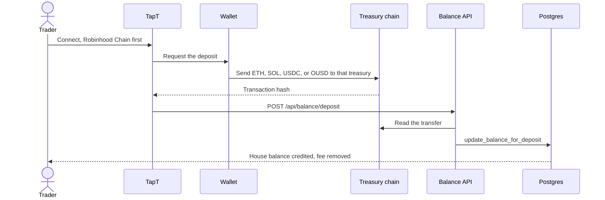
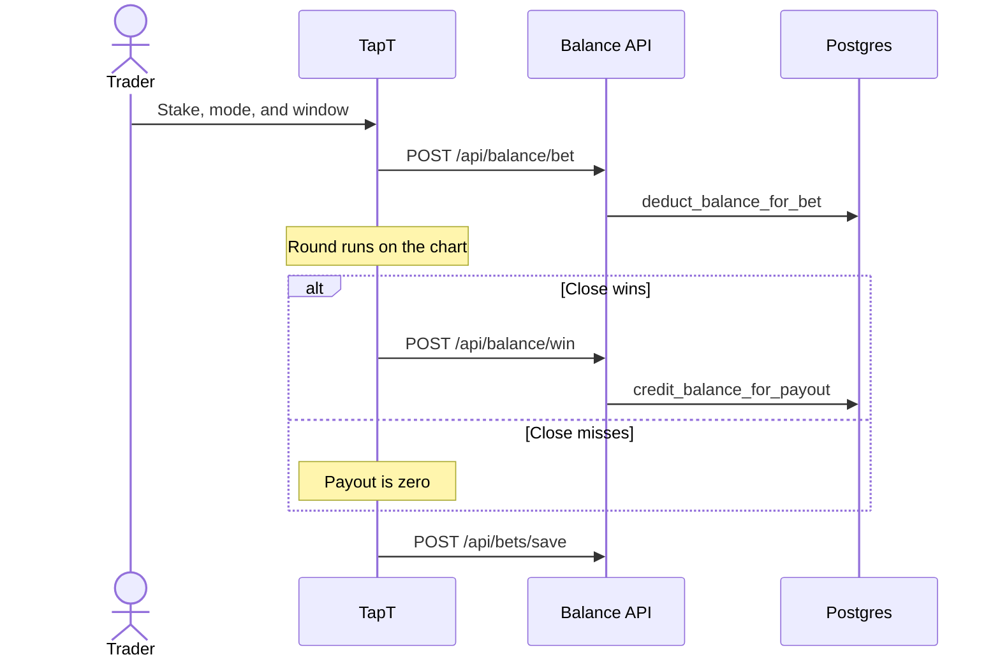
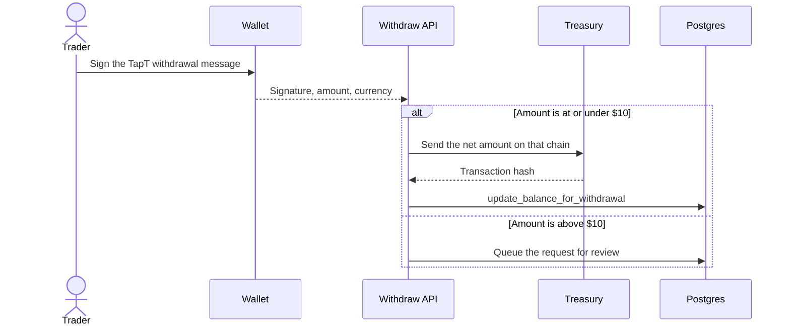

# TapT

Binary options trading platform for crypto, stocks, metals, and FX. A round lasts 5 seconds to 1 minute and settles from a house balance.

| | |
|---|---|
| **Site** | https://tapt.fun |
| **Trade** | https://tapt.fun/trade |
| **Litepaper** | https://tapt.fun/litepaper |
| **Pitch deck** | https://docs.google.com/presentation/d/1fU8I2s4G7NfGJGbwYn-6qHP0JO45BBTLO-1hhKIBdzQ/edit?usp=sharing |
| **GitHub** | https://github.com/AmaanSayyad/TapT |
| **X** | https://x.com/TapT_fun |
| **Contact** | https://t.me/tapt_fun |

---

## Story and inspiration

In 2021, I saw an advertisement for a forex binary options app called Binomo. It was a mobile app promoted by big influencers. I tried the free paper mode and made 10× in a week. Then I put in three months of savings in real mode, and lost it all.

Later I found Reddit threads showing that Binomo ran on algorithms that let users win in trial mode and lose in real mode. This happened to millions of traders.

That day I decided to build a transparent binary options platform, with the settlement price coming from a public feed instead of a hidden book. In 2021, a sub-second price on a wallet chart was not something I could ship. I waited five years. In 2026 the tools were ready. TapT is the result.

Robinhood Chain is the home network. Stocks on the chart read the Chainlink feed there. Solana, Base, Arbitrum, and Tempo are the other live desks.

---

## The problem

- Binary options in Web3 still are not a production product. Web2 apps such as Binomo and IQ Option are opaque. Traders do not custody the balance, and they cannot check the price that settled the round.
- A round is a few seconds long. A wallet signature on every stake is slower than the round.
- Stock, metal, and FX charts and crypto wallets sit in different products.
- A payout sent on the wrong chain never arrives. Each chain needs its own treasury and its own house balance.

---

## The solution

TapT separates funding from the round.

1. The trader connects a wallet. Robinhood Chain is first.
2. They deposit that chain’s asset into that chain’s treasury and receive a house balance.
3. Classic, Box, and Draw debit that balance. There is no wallet signature on the stake.
4. The round settles against the live chart. A win credits `stake × multiplier`. A miss pays zero.
5. A withdrawal sends the asset from that chain’s treasury back to the wallet.

The chart fills a price from the first source that answers:

1. Stocks use the Chainlink feed on Robinhood Chain.
2. Anything still missing uses Hyperliquid mids.
3. Anything still missing uses public quotes.

The chart asks about once a second. `PYTH_PRO_ENABLE` stays `false`. The price route is still named `/api/pyth/latest`. The desk does not depend on that flag.

There is no project token. The play assets are ETH on Robinhood Chain, SOL on Solana, USDC on Base, ETH on Arbitrum, and OUSD on Tempo.

---

## Who it is for

| Reader | What they use TapT for |
|---|---|
| Wallet traders | A 5s to 60s round without a signature on every stake |
| People who left Web2 binary apps | A round they can check against a public price, with the balance in their wallet until they deposit |
| Stock and FX watchers | The same chart for equities, metals, and FX, with Robinhood Chain as the primary desk |
| Operators | The dashboard for treasury balances, the review queue, and invite codes |

---

## Features

- One chart for crypto, stocks, metals, and FX.
- Classic Higher/Lower, Box tiles, and Draw rectangles.
- Blitz on Box: a $0.10 entry, paid to that chain’s treasury, with marked cells at 2×.
- Demo balance in the browser, kept out of the live ledger.
- SMA 20, Bollinger bands (20, 2), Alligator, and RSI 14 on the same ticks.
- One house balance per wallet and per chain asset.
- Deposits and withdrawals at 1% (Free), 0.9% (Standard), and 0.8% (VIP).
- Withdrawals at or under $10 pay immediately. Above $10 they wait for review.
- Referrals at `https://tapt.fun/?ref=`.

---

## Classic

Select Higher or Lower, set the window, and stake from the house balance.

The strike is the chart price when the round starts.

- Higher wins when the close is above the strike.
- Lower wins when the close is below the strike.
- A tie pays zero.

| Window | Multiplier |
|---|---|
| 5s | 1.75× |
| 10s | 1.80× |
| 15s | 1.85× |
| 30s | 1.90× |
| 60s | 1.95× |

At 1.90×, a trader breaks even near a 52.6% win rate. Shorter windows pay less and need a higher win rate to break even.

---

## Box

The live chart shows a grid of tiles. Each tile is a price band and shows its multiplier. The trader taps a tile.

A tile defines `priceBottom`, `priceTop`, the moment the price line reaches that column, and the multiplier.

The round wins when the live price is inside that band as the line reaches the tile. A tighter band pays more. A wider band is easier and pays less. Corner tiles, farther from the current price, pay more because the line is less likely to land there.

Blitz can mark cells in the active window at 2×.

---

## Draw

The trader draws a rectangle to the right of the live price. The rectangle is their own band and time window. The multiplier is shown as the box is drawn.

The rectangle defines `priceBottom`, `priceTop`, `startTime` on the left edge, and `endTime` on the right edge. The left edge has to sit in the future.

The round wins when the price stays inside `[priceBottom, priceTop]` from the left edge through the right edge.

The multiplier rises when the box is smaller, farther from the current price, or shorter. The box cannot be taller than 20% of the chart or wider than 20 seconds. A box that is too small to draw is rejected.

---

## Blitz

Blitz is an overlay on Box, not a fourth mode.

```
[──── BLITZ ACTIVE (1 min) ────][──── COOLDOWN (2 min) ────][── BLITZ ACTIVE ──]
```

The entry fee is **$0.10**, paid once per window, on-chain, in that chain’s asset, to **that chain’s treasury**. It is not taken from the house balance, and it is not sent to the platform fee wallet.

During the active minute, marked cells pay 2× on top of the tile multiplier. USDC and OUSD charge exactly $0.10. ETH and SOL charge the token amount that equals $0.10 at the current price.

---

## Chains and treasuries

Robinhood Chain is the primary chain and the default connection. Solana, Base, Arbitrum, and Tempo follow, in that order.

The four EVM treasuries are the same address. A transfer arrives only on the chain it is sent on. Solana has its own address. Secret keys stay in `.env` and in the host environment. They are not in this file.

| Order | Chain | Asset | What to fund | Treasury | Explorer |
|---|---|---|---|---|---|
| 1 | Robinhood Chain | ETH | ETH, for payouts and gas | `0xCBae80461Bb820e4075035F765f8a46fA65a6ded` | [address](https://robinhoodchain.blockscout.com/address/0xCBae80461Bb820e4075035F765f8a46fA65a6ded) |
| 2 | Solana | SOL | SOL, for payouts and fees | `CJGXQbBK2tDjeoLxcU7Dt3buDjaLUWyK3ieG5mHneETZ` | [account](https://solscan.io/account/CJGXQbBK2tDjeoLxcU7Dt3buDjaLUWyK3ieG5mHneETZ) |
| 3 | Base | USDC | USDC for payouts, plus a little ETH for gas | `0xCBae80461Bb820e4075035F765f8a46fA65a6ded` | [address](https://basescan.org/address/0xCBae80461Bb820e4075035F765f8a46fA65a6ded) |
| 4 | Arbitrum | ETH | ETH, for payouts and gas | `0xCBae80461Bb820e4075035F765f8a46fA65a6ded` | [address](https://arbiscan.io/address/0xCBae80461Bb820e4075035F765f8a46fA65a6ded) |
| 5 | Tempo | OUSD | OUSD, for payouts and the network fee | `0xCBae80461Bb820e4075035F765f8a46fA65a6ded` | [address](https://explore.tempo.xyz/address/0xCBae80461Bb820e4075035F765f8a46fA65a6ded) |

| Chain | How you connect | Chain id | Play token |
|---|---|---|---|
| Robinhood Chain | EVM wallet list | 4663 | Native ETH. RPC `https://rpc.mainnet.chain.robinhood.com` |
| Solana | Phantom or Backpack | mainnet-beta | Native SOL |
| Base | EVM wallet list | 8453 | USDC `0x833589fCD6eDb6E08f4c7C32D4f71b54bdA02913`, 6 decimals |
| Arbitrum | EVM wallet list | 42161 | Native ETH. Public RPC `https://arb1.arbitrum.io/rpc` |
| Tempo | EVM wallet list | 4217 | OUSD `0x20c0000000000000000000006a37da5c996874be`, 6 decimals |

Solana is forced to mainnet-beta. A Solana transfer includes a priority fee. A Tempo transfer uses `transferWithMemo`. The memo is the recipient address, left-padded to 32 bytes, and the fee is extra OUSD.

Platform fees do not go to the treasuries.

| Wallet | Address | Chains |
|---|---|---|
| EVM fee wallet | `0x9B4d9039A96Bfd7320C865aaCC69F35b51f425a7` | Robinhood Chain, then Base, Arbitrum, and Tempo |
| Solana fee wallet | `FrhyCAurK5ofXYUz6G4okUwBqfTFKbLJXrVJDrK5SEFu` | Solana |

---

## Settlement architecture

```
┌─────────────────────────────────────────────────────────────┐
│  OFF-CHAIN (Supabase)                                       │
│  user_balances          balance per wallet and asset        │
│  balance_audit_log      every debit and credit              │
│  bet_history            settled rounds                      │
│  user_sessions          time on the desk                    │
└─────────────────────────────────────────────────────────────┘
         ▲
         │  balance RPCs and session pings
┌────────┴────────────────────────────────────────────────────┐
│  CLIENT (Next.js + Zustand)                                 │
│  Chart price: Chainlink, then Hyperliquid, then quotes      │
│  Round state: active rounds and settled rounds              │
│  Resolution: the chart price at the end of the round        │
└──────────────────────────────────────────────────────────────┘
         ▲
         │  deposits, withdrawals, and the Blitz entry
┌────────┴────────────────────────────────────────────────────┐
│  ON-CHAIN                                                   │
│  Robinhood Chain, Solana, Base, Arbitrum, Tempo             │
│  One treasury per chain holds deposited funds               │
│  Fee wallets receive the deposit and withdrawal fee         │
│  The Blitz $0.10 goes to that chain’s treasury              │
└─────────────────────────────────────────────────────────────┘
```







The EVM withdrawal message is:

```
TapT withdrawal authorization
address:${address}
amount:${amount.toFixed(8)}
currency:${currency}
signedAt:${signedAt}
```

The server rejects a signature older than five minutes. A mainnet withdrawal cannot exceed `total deposited × 1.08`.

---

## Tech stack

| Frontend | Wallets | Server | Tooling |
|---|---|---|---|
| Next.js 16, App Router, Turbopack | ConnectKit, wagmi, and viem for Robinhood Chain, Base, Arbitrum, and Tempo | Next.js route handlers on Vercel | ESLint 9 |
| React 19 and TypeScript | Solana web3.js and wallet-adapter, Phantom and Backpack | Supabase Postgres and RPCs | Jest and Testing Library |
| Tailwind CSS v4 | | Chainlink on Robinhood Chain, Hyperliquid mids, public quotes | Yarn v1 through Corepack, Node 22 |
| Zustand | | ethers 6 for EVM treasury sends | Vercel Analytics and Speed Insights |
| TanStack Query, Framer Motion, d3-shape | | PostHog | |

---

## Monetization

TapT earns on flow. There is no project token.

### 1. Platform fees

Deposits and withdrawals pay a tier fee. The fee moves from the treasury to the fee wallet. It is not left in the treasury.

| Tier | Fee |
|---|---|
| Free | 1% |
| Standard | 0.9% |
| VIP | 0.8% |

`calculateFeeAmount` floors the fee to 8 decimals.

### 2. Round pricing

Classic multipliers sit below 2×. At 1.90×, break-even is about a 52.6% win rate. At 1.75×, break-even is about 57.1%. Box and Draw pay more when the band is tighter or farther from the current price. The admin gameplay tab separates live rounds from demo rounds.

### 3. Blitz entry

$0.10 once per window, in that chain’s asset, sent to that chain’s treasury.

These figures are the live rates. They are not a forecast of volume.

| Monthly round volume, if it is reached | Fee plus round-pricing range used for planning |
|---|---|
| About $5M | About $250k to $500k |
| About $20M | About $400k to $2.0M |

---

## Market

| Segment | Signal | Why it matters |
|---|---|---|
| Binary options | A large retail market for fast up/down outcomes | Traders already understand a short round |
| Crypto prediction markets | Polymarket and Kalshi showed demand for a public settlement price | Those markets resolve in hours or days, not 5 seconds |
| Crypto derivatives | Perps volume is the speculative base | TapT is a fixed window, not a liquidated position |
| TapT | Robinhood Chain first, then Solana, Base, Arbitrum, and Tempo | One chart, five treasuries, a house balance between them |

---

## Competitive landscape

TapT is a short binary round on a public price. It is not a perps venue and it is not an event market.

| Segment | Examples | Compared with TapT |
|---|---|---|
| Web2 binary options | Binomo, IQ Option, Quotex | The price and the book are not visible. Funds sit with the operator. |
| Crypto prediction markets | Polymarket, Kalshi, Azuro | “Will X happen?” resolves in hours or days, not in 5s to 1m. |
| Crypto derivatives | Binance, Bybit, OKX | Funding, leverage, and liquidation. No fixed-expiry binary round. |
| On-chain options | Dopex, Lyra, Premia | Calls and puts, heavier interface, not a 30-second up/down. |
| Fast trading apps | Single-chain perps | Not a binary loop across Robinhood Chain, Solana, Base, Arbitrum, and Tempo. |

---

## Roadmap

| Next | What it changes |
|---|---|
| Robinhood Chain markets | More Chainlink equities on the primary chain |
| More assets | More crypto, FX, stocks, and commodities on the same chart |
| P2P Classic | Match a round between traders instead of only against the house balance, so the treasury is not the only backstop |
| Optional leverage | A 1× to 100× stake multiplier, off by default |
| Trader profiles | Highest P&L, most accurate, largest risk |
| Tournaments | Optional scheduled boards |
| Social trading | Follow, copy, and a public board |
| Mobile | A layout that is comfortable on a phone |
| WalletConnect | Turn the connector back on with a registered project id |

The longer aim is a public binary board for stocks, FX, and crypto: the Web2 binary app, with the price and the payout visible, on Robinhood Chain first.

---

## Go to market

The first audience is wallet traders who already use Robinhood Chain, Solana, Base, Arbitrum, or Tempo and want a short round on a stock or a crypto price. Contact for the project is https://t.me/tapt_fun.

| # | Segment | Who they are | What they use today | TapT hook | Channel |
|---|---|---|---|---|---|
| 1 | DeFi traders | Options, spot, and perps | Funding, liquidation, and a slow ticket | A 5s round, no liquidation, no signature on the stake | Trading groups and Telegram |
| 2 | Web2 binary users | People who used Binomo, IQ Option, or Quotex | A book they cannot check | A public chart price and a wallet | Reddit, YouTube, search |
| 3 | Creators and communities | Trading groups that want a clip, not a whitepaper | No on-chain binary loop | Box, Draw, Blitz, and a shareable result | Short clips and ambassadors |
| 4 | Robinhood Chain | The priority ecosystem | No short binary round on the stock feed | Chainlink equities and ETH as the play asset | Robinhood Chain community, first |
| 5 | Solana, Base, Arbitrum, Tempo | Each chain’s own community | A round that only exists on some other network | Native SOL, USDC, ETH, or OUSD from the same UI | That chain’s groups, after Robinhood Chain |

### Phase 0

Invite testing on Robinhood Chain and Solana. Fee routing, settlement, and the house balance are the checks that matter. PostHog is wired for landing, demo, deposit, and round.

### Phase 1

| Action | Detail |
|---|---|
| Public site | https://tapt.fun |
| Robinhood Chain first | The connect list and the stock chart lead with that chain |
| Then Solana, Base, Arbitrum, Tempo | Each treasury funded in its own asset |
| Referral link | `https://tapt.fun/?ref=` counts one new wallet when it registers |
| Demo | A full round with no wallet, then a deposit into the real balance |

### Phase 2

Ambassador notes, a weekly conversation with traders, Blitz windows with a stated prize if one is funded, public profiles, and a Telegram note before a Blitz window. Grants, if any, start with the Robinhood Chain track and then Solana, Base, Arbitrum, and Tempo.

### Phase 3

P2P Classic, more assets, a mobile layout, and wallet entry points that already exist: Phantom, Backpack, and the EVM wallet list.

| Mechanic | How it works |
|---|---|
| Referral link | A new wallet that arrives from `?ref=` is counted once |
| Demo then deposit | The round can be tried before a treasury transfer |
| Blitz window | One minute on, two minutes off, so the desk has a reason to be open |
| Five chains | Robinhood Chain is the acquisition story. The other four are their own communities |
| Result clips | A settled round is a screenshot, not a thread |

Planning ranges, not current results:

| | Conservative | Base | Optimistic |
|---|---|---|---|
| Average deposit | $50 | $150 | $400 |
| Fee on that deposit at 1% | $0.50 | $1.50 | $4 |
| Average withdrawal | $40 | $120 | $350 |
| Fee on that withdrawal at 1% | $0.40 | $1.20 | $3.50 |
| Blitz entries per user each month | 2 | 5 | 15 |
| Blitz fees | $0.20 | $0.50 | $1.50 |

---

## Why now

| Signal | Detail |
|---|---|
| The wait | In 2021 a public sub-second chart on a wallet was not shippable. In 2026 Chainlink on Robinhood Chain, plus Hyperliquid and public quotes, can fill the chart about once a second. |
| The chain | Robinhood Chain is the priority. Stocks and the default wallet are the same network. |
| The product | Deposits, house balances, and withdrawals already run on the five treasuries. |
| The gap | Web2 binary apps are restricted in many places. A short on-chain round is still rare. |

---

## Team and company

TapT is a company. It is a long-term product. The hackathon is a public checkpoint, not the end of the desk.

The founder is one person: Amaan Sayyad, a blockchain developer and entrepreneur in Navi Mumbai, India.

| | |
|---|---|
| Role | Solo founder |
| Experience | 50 hackathon wins, 10+ shipped Web3 products, 3 times a founder, 8 companies, 12 times a speaker, 3 grants. Research papers, copyrights, and patents. |
| Location | Navi Mumbai, India |
| Email | amaansayyad2001@gmail.com |
| X | https://x.com/amaanbiz |
| TapT on X | https://x.com/TapT_fun |
| GitHub | https://github.com/AmaanSayyad |
| LinkedIn | https://www.linkedin.com/in/amaan-sayyad- |
| Portfolio | https://amaan-sayyad-portfolio.vercel.app |
| Project contact | https://t.me/tapt_fun |

The problem came from using a Web2 binary app. That account is in [Story and inspiration](#story-and-inspiration): a paper-mode win, a real-money loss, and public threads about trial results that did not match real results. The five-year wait was for a public price fast enough to settle a short round.

The same person is building the company because that loss is personal, and the work since then is shipping Web3 products, founding companies, and presenting the work. TapT is the product of that, not a one-week prototype.

Demand and distribution are in [Go to market](#go-to-market). Robinhood Chain is first. Solana, Base, Arbitrum, and Tempo follow as their own communities. A trader can run a demo round before a deposit, and a referral link counts a new wallet.

---

## Environment

One file: `.env`. Do not add `.env.local` or `.env.example`. Next.js would let `.env.local` override `.env`. Do not commit `.env`.

`DASHBOARD_PASSWORD` must be quoted if the value contains `#`.

| Use | Names |
|---|---|
| App | `NEXT_PUBLIC_APP_URL`, `NEXT_PUBLIC_ROUND_DURATION`, `NEXT_PUBLIC_PRICE_UPDATE_INTERVAL`, `NEXT_PUBLIC_CHART_TIME_WINDOW` |
| Robinhood Chain | `NEXT_PUBLIC_ROBINHOOD_TREASURY_ADDRESS`, `ROBINHOOD_TREASURY_SECRET_KEY` |
| Solana | `NEXT_PUBLIC_SOLANA_NETWORK`, `NEXT_PUBLIC_SOLANA_RPC_ENDPOINT`, `SOLANA_RPC_URL`, `NEXT_PUBLIC_SOL_TREASURY_ADDRESS`, `SOL_TREASURY_SECRET_KEY` |
| Base | `NEXT_PUBLIC_BASE_TREASURY_ADDRESS`, `BASE_TREASURY_SECRET_KEY` |
| Arbitrum | `NEXT_PUBLIC_ARBITRUM_TREASURY_ADDRESS`, `ARBITRUM_TREASURY_SECRET_KEY`, `ARBITRUM_RPC_URL` |
| Tempo | `NEXT_PUBLIC_TEMPO_TREASURY_ADDRESS`, `TEMPO_TREASURY_SECRET_KEY` |
| Fee wallets | `NEXT_PUBLIC_PLATFORM_FEE_WALLET_EVM`, `NEXT_PUBLIC_PLATFORM_FEE_WALLET_SOL` |
| Wallets | `NEXT_PUBLIC_WALLETCONNECT_PROJECT_ID`, `NEXT_PUBLIC_PRIVY_APP_ID` |
| Database | `NEXT_PUBLIC_SUPABASE_URL`, `NEXT_PUBLIC_SUPABASE_ANON_KEY`, `SUPABASE_SERVICE_KEY` |
| Settlement | `BALANCE_SETTLEMENT_SECRET`, `BALANCE_INTERNAL_SECRET` |
| Admin | `DASHBOARD_PASSWORD` |
| Prices | `PYTH_PRO_ENABLE` |
| Analytics | `NEXT_PUBLIC_POSTHOG_KEY`, `NEXT_PUBLIC_POSTHOG_HOST` |

`NEXT_PUBLIC_SOLANA_NETWORK` stays `mainnet-beta`. `PYTH_PRO_ENABLE` stays `false`. Names are also listed in `docs/ENVIRONMENT.md`.

---

## Run locally

Node 22. Yarn through Corepack.

1. Install dependencies.

```bash
corepack yarn
```

2. Keep a single `.env`. Use the treasury addresses in the table above. Put secret keys only in `.env`.

3. Apply `supabase/migrations/` to the Supabase project. Balances, rounds, and referrals read those tables.

4. Fund each treasury on its own chain, using the asset column in the treasury table.

5. Start the app.

```bash
corepack yarn dev
```

Open http://localhost:3000.

```bash
corepack yarn build
corepack yarn lint
corepack yarn test
```

Production is https://tapt.fun on Vercel. `NEXT_PUBLIC_APP_URL` there is `https://tapt.fun`. TypeScript errors block the build. The compiler target is ES2022.

---

## API

| Method | Route | Purpose |
|---|---|---|
| `GET` | `/api/balance/[address]` | House balance |
| `POST` | `/api/balance/deposit` | Record a deposit |
| `POST` | `/api/balance/withdraw` | Send a withdrawal |
| `POST` | `/api/balance/bet` | Debit a stake |
| `POST` | `/api/balance/win` | Credit a win |
| `POST` | `/api/bets/save` | Store a settled round |
| `GET` | `/api/bets/history` | Recent rounds |
| `GET` | `/api/bets/leaderboard` | Public board |
| `GET` / `POST` | `/api/pyth/latest` | Latest chart prices |
| `GET` | `/api/robinhood/stocks` | Robinhood Chain stock quotes |

Admin routes require the session from `DASHBOARD_PASSWORD`. The dashboard is `/dashboard`.

Report a vulnerability through `docs/SECURITY_REPORTING.md` or Telegram at https://t.me/tapt_fun.

---

## Links

| | |
|---|---|
| Site | https://tapt.fun |
| Trade | https://tapt.fun/trade |
| Litepaper | https://tapt.fun/litepaper |
| Pitch deck | https://docs.google.com/presentation/d/1fU8I2s4G7NfGJGbwYn-6qHP0JO45BBTLO-1hhKIBdzQ/edit?usp=sharing |
| Leaderboard | https://tapt.fun/leaderboard |
| GitHub | https://github.com/AmaanSayyad/TapT |
| X | https://x.com/TapT_fun |
| Contact | https://t.me/tapt_fun |
| Founder | Amaan Sayyad, Navi Mumbai |
| Robinhood Chain | https://robinhoodchain.blockscout.com |
| Solana | https://solscan.io |
| Base | https://basescan.org |
| Arbitrum | https://arbiscan.io |
| Tempo | https://explore.tempo.xyz |
